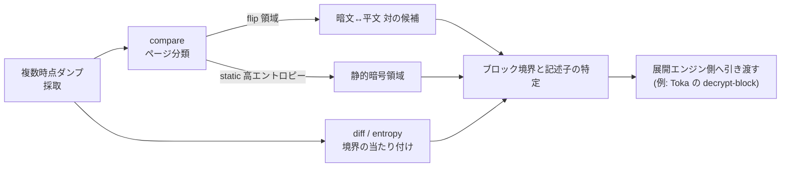

# izayoi(十六夜)— 複数時点メモリダンプ比較ツールキット

同一プロセスの**複数時点のメモリダンプ**を比較し、
「どの領域が静的か・どこが一時的にだけ書き換わるか・どこが暗号化されているか」
を割り出すツールキット。パッカー・DRM・マルウェア解析の
**探索段階(暗号方式がまだ分からない時期)** を支援する。

十六夜は満月の翌晩、もう一度現れるのをためらう月。
**同じ対象を異なる時点で観測し、移ろいと不動を見分ける**
本ツールの名。旧称 dumpdiff(v0.4.0 で改名)。

標準ライブラリのみで動作する(NumPy は任意依存・導入すると
ホットパスが自動的にベクトル化実装に切り替わる)。
外部ダンプ不要の合成データによるテストスイートを同梱する。

## 想定ワークフロー



## コマンド

| コマンド | 機能 |
| --- | --- |
| `entropy` | ページ単位のエントロピーマップと高エントロピー領域(暗号・圧縮候補)の列挙 |
| `diff` | 2ダンプ間の差分「ラン」(連続不一致領域)の列挙・併合・最小長フィルタ |
| `compare` | 2〜3時点ダンプのページ分類 (`--ranges` で連続領域も表示) |
| `pairs` | 暗文↔平文ページ対の推定。候補を展開エンジンの記述子形式で出力 |
| `report` | 上記全体を1本のMarkdown/JSONレポートに |

### ページ分類ラベル(3時点)

| ラベル | 条件 | 解釈 |
| --- | --- | --- |
| `static` | 全時点一致 | 静的領域(暗号文・データとも安定) |
| `flip` | 時点1==時点3 かつ時点2が異なる | **一時的にだけ内容が変わる領域** = 復号→実行→復元の候補 |
| `settled` | 時点1≠時点2==時点3 | 遷移後の状態書込 |
| `volatile` | それ以外(全不一致含む) | 状態書込・ヒープ等 |

2イメージ比較では `static` / `volatile` のみを返す。

### 暗文↔平文対の推定 (`pairs`)

「一方のダンプでは暗号化され、他方では平文に展開されている」領域を
ページ単位のスコアから推定する:

- **2イメージ**: 一方が `cipher` (エントロピー >= 7.0) で他方が
  `code` (x86 風パターン密度) / `strings` (印刷可能文字比率)、
  かつエントロピー差 >= 0.5 のページを候補にする
- **3イメージ**: `compare` の `flip` ページを候補にし、
  2 状態のエントロピー比較で暗文側/平文側を決める
- 候補範囲はダンプ間の差分ランで境界精密化 (`refined`)
- 候補は展開エンジンの記述子形式 `off1:size1:off2:size2` で出力される
  (**サイズは範囲からの推定値**。展開エンジン側で調整すること)

## インストール

```bash
pip install izayoi        # PyPI から
pip install izayoi[fast]  # NumPy による高速化も有効化

# ソースから
git clone https://github.com/sh-sunfaded/i zayoi.git
cd Izayoi
pip install .
```

Git からではなくソースツリーを直接使う場合は `PYTHONPATH=.` でも動作する。

## 使用例

```bash
# 高エントロピー領域(暗号・圧縮候補)の列挙
izayoi entropy dump1.bin --threshold 7.0

# 2ダンプ間の差分ラン(16バイト以内の一致で隔てられたランを併合)
izayoi diff dump1.bin v1d.bin --merge-gap 16 --min-length 8

# 3時点比較: static / flip / settled / volatile
izayoi compare dump1.bin v1d.bin w1.bin --ranges

# 暗文↔平文対の推定(候補を記述子形式で出力)
izayoi pairs dump1.bin v1d.bin
izayoi pairs dump1.bin v1d.bin w1.bin --json

# レポート生成
izayoi report dump1.bin v1d.bin w1.bin --out report.md
izayoi report dump1.bin v1d.bin --json --out report.json
```

`pip install` 済みなら `izayoi` コマンドが、ソースツリーからは
`python -m izayoi.cli <cmd> ...` でも動作する。

### Python API

```python
from izayoi import load_image, classify_pages, diff_runs, high_entropy_ranges

img1, img2, img3 = (load_image(p) for p in ("dump1.bin", "v1d.bin", "w1.bin"))

# 一時的にだけ書き換わる領域(flip)を探す
for off, label in classify_pages([img1, img2, img3]):
    if label == "flip":
        print(hex(off), label)

# 差分ランからブロック境界を当たり付けする
for run in diff_runs(img1, img2, merge_gap=16):
    print(hex(run["offset"]), run["length"], run["kind"])
```

## 入力形式

- **RVA==ファイルオフセット** 形式の生ダンプを想定
- 一部の採取ツールが先頭に付けるテキストヘッダ
  (例: `REGION image addr=... size=...` + 改行)は自動除去する
- 長さの異なるイメージも比較可能(共通範囲のみページ分類、超出部は `a-only`/`b-only` ラン)

## 制限

- ページ保護情報はダンプ由来のものしか使えない(保護属性は入力に含めない)
- ヒープなどダンプ外に実体があるデータの復元は対象外
- `flip`/`settled` はあくまで候補の列挙であり、意味の確定は
  平文側の内容(x86コードらしさ等)を別途確認すること
- `pairs` の記述子のサイズは推定値(起点は信頼度高・サイズは要調整)

## パフォーマンス (任意依存: NumPy)

NumPy (`numpy>=1.26`・Python>=3.9) が導入されている環境では、
ホットパスが自動的にベクトル化実装 (`izayoi.fastpath`) に
切り替わる。コアは一貫して標準ライブラリのみで動作し、
結果は等価(テストスイートの等価性検証で担保)。

| 対象 | ベクトル化の方法 |
| --- | --- |
| `shannon_entropy` / `entropy_map` | ページごとのバイトヒストグラムを `bincount` で一括作成し、エントロピーをページ軸でまとめて計算 |
| `diff_runs` | `a != b` のバイトマスクからラン境界を `flatnonzero`/`diff` で一括抽出 |
| `classify_pages` | ページごとの md5 掛り比較をやめ、フルページ範囲を 2D 化して一括バイト比較(md5 衝突も原理的に排除) |
| `pairs` のページ分類 | ヒストグラム行列から entropy/zero/strings 比率を、2 バイト窓の `bincount` から code 密度を、それぞれページ軸でまとめて計算 |

ベクトル化しない箇所(ラン数に対する後処理で元々軽量):
diff ランの併合 (`merge_gap`)・`min_length` フィルタ、
`pairs` の候補併合・境界精密化・記述子整形。

## テスト

```bash
PYTHONPATH=. python3 tests/test_izayoi.py    # 合成データのみ・外部ダンプ不要
```

NumPy 導入環境では上記に加えて fastpath の**等価性テスト**
(ベクトル化実装 vs 純実装)が自動実行される。
未導入環境では当該テストはスキップされ、コアは純実装で動く。

## 今後の予定

- `pairs` 推定精度の改良(コードスコアのチューニング・候補と
  展開エンジン(Toka等)との往復検証の整備)

