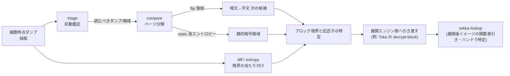

# izayoi(十六夜) — 複数時点メモリダンプ比較ツールキット

同一プロセスの**複数時点のメモリダンプ**を比較し、「どの領域が静的か・どこが一時的にだけ書き換わるか・どこが暗号化されているか」を割り出すツールキットです。パッカー・マルウェア解析やJIT・自己変換コードのデバッグなど、暗号化と変換が絡む**探索段階(方式がまだ分からない時期)**の観測を支援します。

さらに**triage**コマンドで「手元のダンプ群をまず何を見るべきか」に答える初動鑑定(PEヘッダ検出・ページ分類の集計・「この領域はどのダンプで読むべきか」の推定)をワンステップで出力します。

十六夜は満月の翌晩、もう一度現れるのをためらう月。**同じ対象を異なる時点で観測し、移ろいと不動を見分ける**本ツールの名です。旧称 dumpdiff(v0.4.0で改名)。

コアは標準ライブラリのみで動作します(NumPyは任意依存、導入するとホットパスが自動的にベクトル化実装に切り替わる)。外部ダンプ不要の合成データによるテストスイートを同梱します。

## 概要

- 6つのコマンド: `triage`(初動鑑定) / `entropy` / `diff` / `compare` / `pairs` / `report`
- 3時点ダンプをページ単位で分類(static / flip / settled / volatile)。`flip`は復号→実行→復元の候補領域
- `pairs`は暗文↔平文ページ対を`off1:size1:off2:size2`記述子で出力し、展開エンジン(Toka等)へ直結できる
- コアは標準ライブラリのみ(NumPyは任意依存)。合成データのみで完結するテストスイートを同梱

## 背景: ページ単位の比較は低レベル観察の基本線

アドレス空間をページ(既定4KiB)単位の独立な観察単位に切り分けて眺めるのは、メモリフォレンジックの定石です:

- **ページごとのエントロピー**は、コード・データ・暗号文・ゼロ埋めを分類する最初の尺度(binwalk系ツールの事前走査と同じ原理)
- **差分ラン(diff run)**は、2状態の差異を「連続不一致区間」の列に変換する古典手法(インクリメンタルバックアップやページキャッシュのdirty追跡と同型の計算)
- **3時点比較のflip検出**は「一時的にだけ書き換わる」領域、すなわち復号→実行→復元のような遷移を時間軸から切り出す

いずれも対象を観測(読み取り)するだけで、ダンプやプロセスへの介入は行いません。

## 想定ワークフロー



## コマンド

| コマンド | 機能 |
| --- | --- |
| `triage` | 初動鑑定: PEヘッダ検出・REGIONヘッダ解析・ページ分類の集計・読みやすい資産(平文)の所在推定 |
| `entropy` | ページ単位のエントロピーマップと高エントロピー領域(暗号・圧縮候補)の列挙 |
| `diff` | 2ダンプ間の差分「ラン」(連続不一致領域)の列挙・併合・最小長フィルタ |
| `compare` | 2〜3時点ダンプのページ分類(`--ranges`で連続領域も表示) |
| `pairs` | 暗文↔平文ページ対の推定。候補を展開エンジンの記述子形式で出力 |
| `report` | 上記全体(トリアージ込み)を1本のMarkdown/JSONレポートに |

### triage: 初動鑑定

ダンプを初めて開くときに必要な初動鑑定をまとめて行います:

- **PEヘッダ検出**(`detect_pe`) — 先頭4KBの窓からMZ/PEを探し、PE32/PE32+の機種・イメージベース・`SizeOfImage`・セクション表を読む。セクションrawオフセットとRVAの一致から**メモリキャプチャ(RVA==オフセット)かオンディスクファイルか**を判定し、ダンプ長 vs `SizeOfImage`から**カバレッジ**(画像全体が採れているか)を出す
- **REGIONヘッダ解析**(`region_info`) — 採取ツールが付ける`REGION ... addr=... size=...`行から採取条件を復元
- **ページ分類の集計**(`page_census`) — 各ダンプのcipher / zero / code / strings / dataページ数を一覧
- **読みやすい資産の所在推定**(`readable_sources`) — 複数時点ダンプの同じページを見比べ、最も平文らしい状態(code/strings > data > zero > cipher、同ランクなら低エントロピー優先)を持つダンプを領域単位で選ぶ。**「この領域はどのダンプで読むべきか」の答え**
- **資産ランキング**(`readability_ranking`) — 平文ページ数順にダンプを並べ、最初に読むべきダンプを提示

### ページ分類ラベル(3時点)

| ラベル | 条件 | 解釈 |
| --- | --- | --- |
| `static` | 全時点一致 | 静的領域(暗号文・データとも安定) |
| `flip` | 時点1==時点3 かつ時点2が異なる | **一時的にだけ内容が変わる領域** = 復号→実行→復元の候補 |
| `settled` | 時点1≠時点2==時点3 | 遷移後の状態書込 |
| `volatile` | それ以外(全不一致含む) | 状態書込・ヒープ等 |

2イメージ比較では`static` / `volatile`のみを返します。

### pairs: 暗文↔平文対の推定

「一方のダンプでは暗号化され、他方では平文に展開されている」領域をページ単位のスコアから推定します:

- **2イメージ**: 一方が`cipher`(エントロピー >= 7.0)で他方が`code`(x86風パターン密度) / `strings`(印刷可能文字比率)、かつエントロピー差 >= 0.5のページを候補にする
- **3イメージ**: `compare`の`flip`ページを候補にし、2状態のエントロピー比較で暗文側/平文側を決める
- 候補範囲はダンプ間の差分ランで境界精密化(`refined`)
- 候補は展開エンジンの記述子形式`off1:size1:off2:size2`で出力される(**サイズは範囲からの推定値**。展開エンジン側で調整すること)

## インストール

```bash
pip install izayoi        # PyPIから
pip install izayoi[fast]  # NumPyによる高速化も有効化

# ソースから
git clone https://github.com/sh-sunfaded/izayoi.git
cd izayoi
pip install .
```

ソースツリーを直接使う場合は`PYTHONPATH=.`でも動作します。

## 使用例

```bash
# 初動鑑定: PE検出・ページ集計・「どのダンプでどこを読むべきか」
izayoi triage dump1.bin v1d.bin w1.bin
izayoi triage dump1.bin v1d.bin --json

# 高エントロピー領域(暗号・圧縮候補)の列挙
izayoi entropy dump1.bin --threshold 7.0

# 2ダンプ間の差分ラン(16バイト以内の一致で隔てられたランを併合)
izayoi diff dump1.bin v1d.bin --merge-gap 16 --min-length 8

# 3時点比較: static / flip / settled / volatile
izayoi compare dump1.bin v1d.bin w1.bin --ranges

# 暗文↔平文対の推定(候補を記述子形式で出力)
izayoi pairs dump1.bin v1d.bin
izayoi pairs dump1.bin v1d.bin w1.bin --json

# レポート生成
izayoi report dump1.bin v1d.bin w1.bin --out report.md
izayoi report dump1.bin v1d.bin --json --out report.json

# バージョン確認
izayoi --version
```

`pip install`済みなら`izayoi`コマンドが、ソースツリーからは`python -m izayoi.cli <cmd> ...`でも動作します。

## Python API

```python
from izayoi import load_image, classify_pages, diff_runs, high_entropy_ranges

img1, img2, img3 = (load_image(p) for p in ("dump1.bin", "v1d.bin", "w1.bin"))

# 一時的にだけ書き換わる領域(flip)を探す
for off, label in classify_pages([img1, img2, img3]):
    if label == "flip":
        print(hex(off), label)

# 差分ランからブロック境界を当たり付けする
for run in diff_runs(img1, img2, merge_gap=16):
    print(hex(run["offset"]), run["length"], run["kind"])

# 初動鑑定: PE検出と「この領域はどのダンプで読むべきか」
from izayoi import detect_pe, triage

pe = detect_pe(img1)
print(pe["bitness"], pe["machine"], hex(pe["image_base"]))

info = triage(["dump1.bin", "v1d.bin"])
for r in info["readable"]:
    print(hex(r["start"]), r["source"], r["kind"])
```

## 入力形式

- **RVA==ファイルオフセット**形式の生ダンプを想定
- 一部の採取ツールが先頭に付けるテキストヘッダ(例: `REGION image addr=... size=...` + 改行)は自動除去する
- 長さの異なるイメージも比較可能(共通範囲のみページ分類、超出部は`a-only` / `b-only`ラン)

## パフォーマンス(任意依存: NumPy)

NumPy(`numpy>=1.26`・Python>=3.9)が導入されている環境では、ホットパスが自動的にベクトル化実装(`izayoi.fastpath`)に切り替わります。コアは一貫して標準ライブラリのみで動作し、結果は等価です(テストスイートの等価性検証で担保)。

| 対象 | ベクトル化の方法 |
| --- | --- |
| `shannon_entropy` / `entropy_map` | ページごとのバイトヒストグラムを`bincount`で一括作成し、エントロピーをページ軸でまとめて計算 |
| `diff_runs` | `a != b`のバイトマスクからラン境界を`flatnonzero` / `diff`で一括抽出 |
| `classify_pages` | ページごとのmd5掛り比較をやめ、フルページ範囲を2D化して一括バイト比較(md5衝突も原理的に排除) |
| `pairs`のページ分類 | ヒストグラム行列からentropy / zero / strings比率を、2バイト窓の`bincount`からcode密度を、それぞれページ軸でまとめて計算 |
| `triage`のページ集計/資産分布 | `pairs`と同じ一括ページ分類を流用(新規ホットパスなし)。PEヘッダ検出は数KBの窓のみで元々軽量 |

ベクトル化しない箇所(ラン数に対する後処理で元々軽量): diffランの併合(`merge_gap`)・`min_length`フィルタ、`pairs`の候補併合・境界精密化・記述子整形。

## 関連ツール

同じメモリフォレンジックの流れで併用できる姉妹ツール:

- [Toka](https://github.com/sh-sunfaded/Toka) — パッカー/VMで保護されたブロックの復号・展開。`pairs`が出力する記述子`off1:size1:off2:size2`はTokaの`--desc`にそのまま渡せる
- [Sekka](https://github.com/sh-sunfaded/Sekka) — x64 PE例外テーブル(.pdata)の静的解析。展開後の平文イメージから関数境界・例外ハンドラを引ける

## 制限

- ページ保護情報はダンプ由来のものしか使えない(保護属性は入力に含めない)
- ヒープなどダンプ外に実体があるデータの復元は対象外
- `flip` / `settled`はあくまで候補の列挙であり、意味の確定は平文側の内容(x86コードらしさ等)を別途確認すること
- `pairs`の記述子のサイズは推定値(起点は信頼度高・サイズは要調整)

## 今後の予定

- `pairs`推定精度の改良(コードスコアのチューニング、候補と展開エンジン(Toka等)との往復検証の整備)
- `triage`の拡張(セクション単位の集計、ダンプ時系列の整列推定)

## テスト

```bash
PYTHONPATH=. python3 tests/test_izayoi.py    # 合成データのみ・外部ダンプ不要
```

NumPy導入環境では上記に加えてfastpathの**等価性テスト**(ベクトル化実装 vs 純実装)が自動実行されます。未導入環境では当該テストはスキップされ、コアは純実装で動きます。

## ライセンス

Apache-2.0([LICENSE](LICENSE)を参照)。
